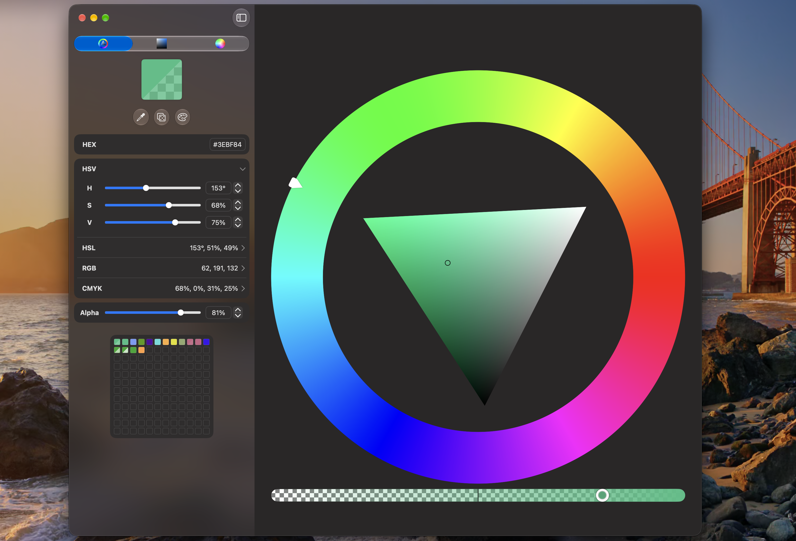
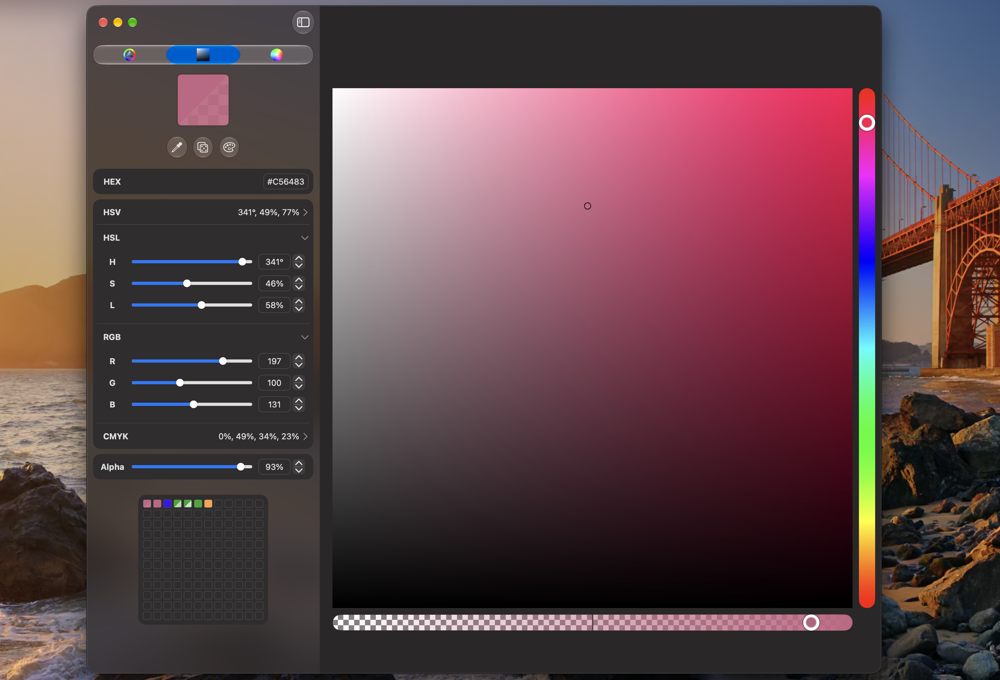
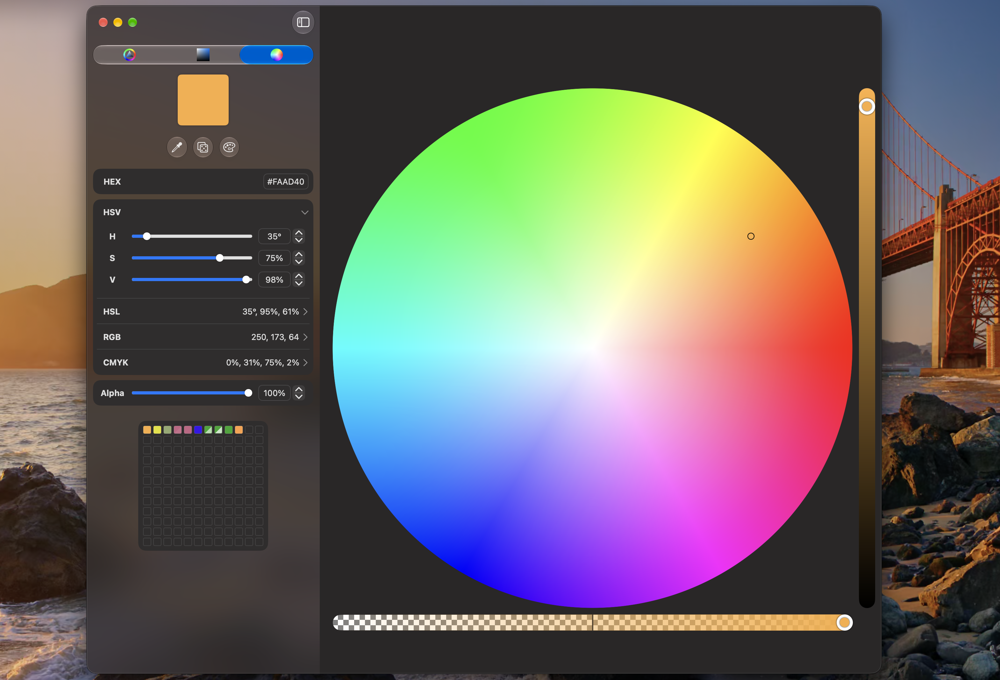

<div align="center">
  
# CustomColorPanelKit 🎨

[](https://github.com/kralloie/CustomColorPanelKit/actions/workflows/tests.yml)


A color-picking panel for macOS, built with SwiftUI and Metal. It combines GPU-rendered color pickers with precise component controls in a native macOS interface.

</div>

<p align="center">
  
  
  
</p>

## Features

### Three color pickers
- Hue Ring — Select hue around a ring, then adjust saturation and brightness using the triangle inside it.
- HSV Square — Adjust saturation and brightness in a square, with a separate hue slider.
- Hue Sphere — Select hue by angle and saturation by distance from the center, with a separate brightness slider.
  
Each picker includes an opacity slider.

### Color controls
- Editable HEX, HSV, HSL, RGB, and CMYK values, plus alpha.
- Sliders, text fields, and steppers for individual color components.
- On-screen color preview with an opacity checkerboard.
- Copy color values in HEX, HSV, HSL, RGB, or CMYK format.
- Eyedropper for sampling a color from the screen.
- Random color generator and six preset palettes: System, Classic, Pastel, Neon, Warm, and Cool.
- Color history per panel holding up to 144 entries (not saved across app launches).

### Accessibility and localization
- Localized interface strings for 13 languages.
- Accessibility representations and modifiers for controls and previews in the sidebar.

## Usage

Import `CustomColorPanelKit` and provide a binding to a SwiftUI `Color`:

```swift
import SwiftUI
import CustomColorPanelKit

struct ContentView: View {
    @State private var selectedColor: Color = .blue

    var body: some View {
        ColorPanelView($selectedColor, initialMode: .hsvSquare)
    }
}
```

`initialMode` selects the panel’s initial picker and defaults to `.hueRing` when omitted. 
Available modes are `.hueRing`, `.hsvSquare`, and `.hueSphere`.

Changes made in the panel update `selectedColor`. Changes to the bound color from elsewhere in your app are also reflected in the panel.
`ColorPanelView` is the package's public entry point. Component controls are managed internally.

## Requirements 
- macOS 26 or later
- Xcode with Swift 6.2 support
  
## Installation
1. In Xcode, open your macOS app project.
2. Select File → Add Package Dependencies…
3. Enter the GitHub repository URL for CustomColorPanelKit https://github.com/kralloie/CustomColorPanelKit.
4. Select a compatible package version and add CustomColorPanelKit to your app target.

The package has no third-party Swift Package dependencies.
